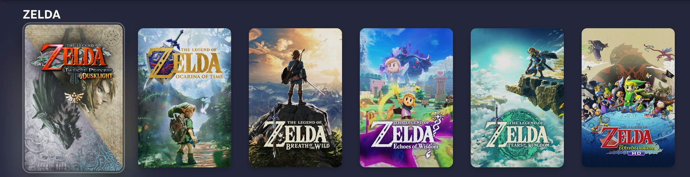
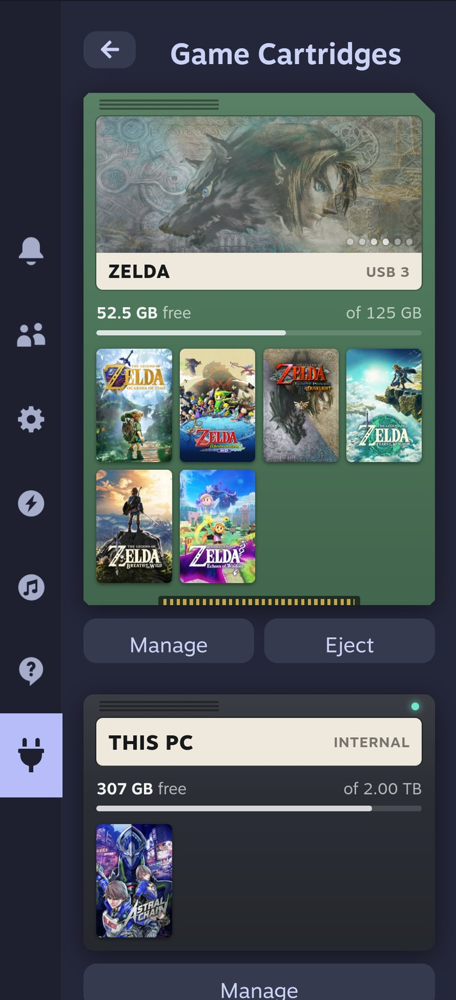
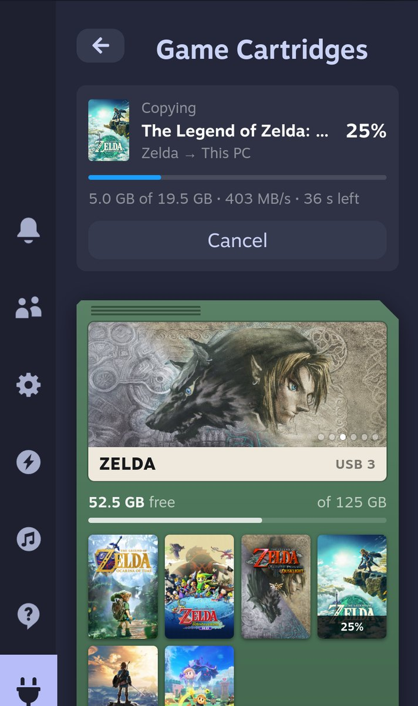
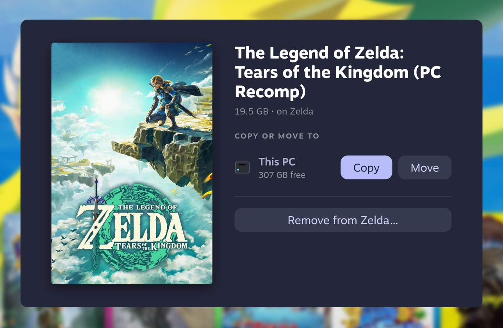
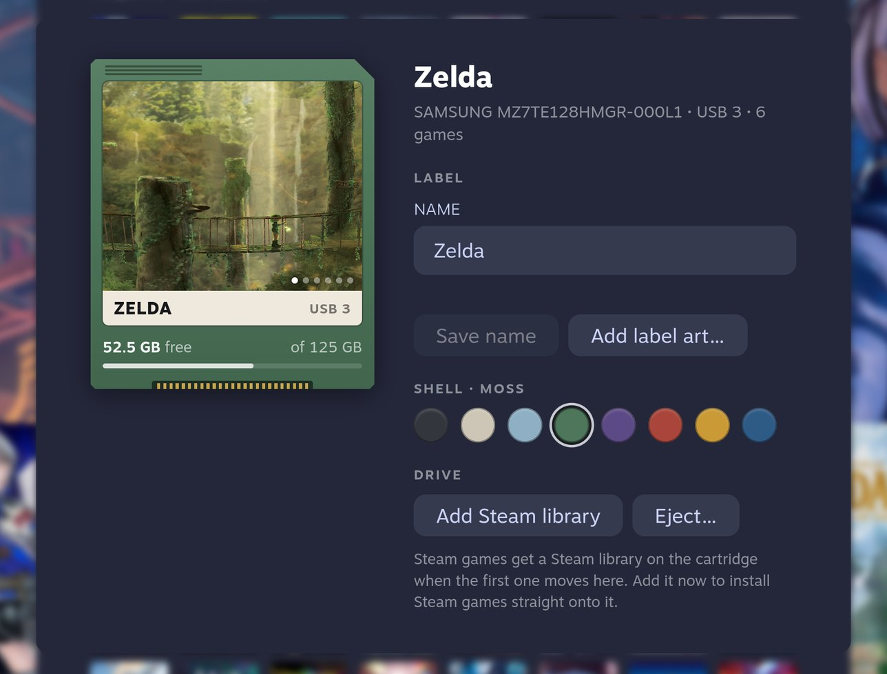

# Game Cartridges

A [Decky Loader](https://github.com/SteamDeckHomebrew/decky-loader) plugin for Bazzite and SteamOS
that turns USB SSDs into game cartridges. Plug one in and its games appear in the Steam library in
Game Mode. Unplug it and they are hidden again. Saves and settings stay on each machine, so one
cartridge can go from your PC to your Steam Deck to a friend's machine.



## What it does

Every plugged-in cartridge shows up in the Quick Access menu with its label, free space and games.
The machine's internal storage appears the same way, as **This PC** (or **This Deck**), with the
Steam games installed on it.

<p>
  
  
</p>

Select a game to copy or move it to another cartridge or to This PC, or to remove it. A copy shows
its speed and the time left, and **Cancel** deletes the partial files. A game that moves keeps its
Steam entry, play time and controller layout. The same options are in the game's menu in the Steam
library, under **Game cartridge…**. Steam games are moved by Steam itself and can't be copied, since
Steam keeps one install of a game per machine.

<p>
  
  
</p>

**Manage** renames a cartridge, sets its label art and shell colour, adds a Steam library to it and
ejects it. If programs still use the drive, Eject lists them first. A cartridge without label
art shows the hero images of its games in turn. Each cartridge also gets a Steam collection with its
name.

An empty USB drive shows up as "Not a cartridge yet". **Make cartridge…** shows the drive's model,
size and contents, and erases it only after you confirm. Cartridges are plain ext4 drives, which
SteamOS and Bazzite mount on their own. If a cartridge sits in a USB 2 port, the plugin warns you,
because games load very slowly there.

## Installing

You need Bazzite or SteamOS with Decky Loader, and a USB SSD. The plugin is not in the Decky store
yet, so it is installed from a release:

1. In Decky's settings, turn on **Developer mode** under General.
2. Under **Developer**, use **Install Plugin from URL** with
   `https://github.com/saschb2b/decky-game-cartridges/releases/latest/download/game-cartridges.zip`.
   If you have downloaded the zip already, **Install Plugin from ZIP File** works as well.
3. Open **Game Cartridges** in the Quick Access menu. If it says the cartridge service is missing,
   press **Install service**.

The cartridge service (`game-cartridges.service`) runs as your user. It watches for cartridges and
adds or hides their games in Steam. Nothing outside your home folder is changed.

## Using a cartridge on another machine

Each machine needs the cartridge service once. With the plugin installed, the panel offers it. A
machine without Decky can run the installer that every cartridge carries, from a terminal in Desktop
Mode:

```bash
bash "/run/media/$USER/<cartridge name>/cartridge/agent/install.sh"
```

The `README.txt` on each cartridge explains the same. Only plug in cartridges you trust: pressing
Play runs the cartridge's `launch.sh`.

## Which games can go on a cartridge

Steam games go on a cartridge as they are. Moving one there puts it in a Steam library on the
cartridge, using Steam's own "Move install folder", so Steam keeps handling updates. Whenever the
cartridge is plugged in, the cartridge service adds that library to Steam, and the games show as
installed. When it is unplugged, the library is removed again and they show as not installed. On
another machine a game still needs your account or Family Sharing. Windows games keep their Proton
data in the library, so their saves travel with the cartridge unless the game uses Steam Cloud.

Games from outside Steam need a folder `games/<id>/` with a `launch.sh` that finds its own location,
so it works at any mount path, and that keeps saves and settings in
`~/.local/share/game-cartridges/<id>/` on the machine. PC ports and recompilations, emulators with
their games, and DRM-free Linux games all fit. Windows games from outside Steam need their own
launcher for now, since the shared helpers have nothing for Proton yet. The plugin copies, moves and
removes these games, but setting one up the first time is done by hand. [FORMAT.md](FORMAT.md)
describes the layout, and [examples/zelda](examples/zelda) has the launchers of a real cartridge.

## Status

Version 0.1.0, tested on a Bazzite PC so far. Reports from SteamOS and the Steam Deck are welcome,
and so are bug reports and pull requests. [CONTRIBUTING.md](CONTRIBUTING.md) explains how to set up
and what the checks are. [CHANGELOG.md](CHANGELOG.md) lists what changed in each version.

## Building

You need Node.js with pnpm, and Python 3.

```bash
pnpm install
pnpm run build
python3 tools/package.py
```

That writes `out/game-cartridges.zip`. The tests and linters are described in
[CONTRIBUTING.md](CONTRIBUTING.md). `tools/install.sh` builds the zip, copies it to a machine and
installs it through Decky's own installer. It confirms Decky's prompt over Steam's debug port, so it
needs an SSH tunnel to that port:

```bash
ssh -N -L 18090:127.0.0.1:8080 user@machine
```

```bash
HOST=user@machine tools/install.sh
```

The repository has three parts. The Decky plugin (`main.py`, `backend/`, `src/`) formats drives and
manages cartridges. `cartridge/` is what every cartridge carries: the launcher helpers in `lib.sh`,
and the agent, which is the service that adds and hides games in Steam. `tools/format-cartridge.sh`
makes a cartridge from a shell, without the plugin.

The plugin's backend runs as root so it can format drives. Everything it writes on a cartridge or in
your home folder is written as your user. Only the agent adds Steam shortcuts, so the plugin and the
agent never add the same game twice.

Logs are in `~/homebrew/logs/game-cartridges/` for the plugin, and in
`journalctl --user -u game-cartridges` for the agent.

## License

MIT, see [LICENSE](LICENSE). The build setup started from Decky's plugin template, whose license is in
[LICENSE-decky-plugin-template](LICENSE-decky-plugin-template).
